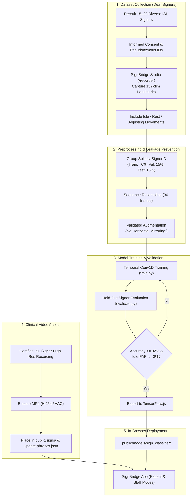

# SignBridge: Production ISL Pipeline & Real-World Validation Blueprint

This guide provides the exact clinical, machine-learning, and engineering workflow required to transition SignBridge from a functional prototype to a **100% real, clinically-validated Indian Sign Language (ISL) communication assistant**.

---

## 🗺️ High-Level System Architecture



---

## Phase 1: Linguistic Standardization & Clinical Ethics

Before recording any data, establish the exact signs with deaf community representatives.

### 1. Linguistic Partnership
* **Partner Organization**: Connect with the **Indian Sign Language Research and Training Centre (ISLRTC)**, **National Institute of Hearing Handicapped (AYJNISHD)**, or local Deaf Associations.
* **Dialectal Consensus**: ISL exhibits regional dialectal variations (e.g. North India vs. South India). For hospital triage, select the canonical pan-Indian forms documented in the [ISLRTC 10,000 Sign Dictionary](http://www.islrtc.nic.in/).
* **Target Vocabulary (11 Classes)**:
  1. `idle`: Rest position, hands dropping, scratching, adjusting clothing, resting on lap.
  2. `help`: Dominant fist with thumb up moving upward supported on flat non-dominant palm.
  3. `doctor`: Index and middle fingers tapping pulse point on wrist.
  4. `pain`: Opposing twisting index fingers directed toward pain area.
  5. `water`: C-cup / W-handshape tilted at mouth.
  6. `toilet`: T-handshape gently shaken side-to-side.
  7. `yes`: Closed fist nodding vertically.
  8. `no`: Index/middle fingers snapping against thumb or side-to-side open hand wave.
  9. `thank_you`: Flat open hand moving forward from chin/lips.
  10. `wait`: Open palms facing upward with fingers held steady or gentle fluttering.
  11. `emergency`: Urgent vibrating/waving across chest.

### 2. Ethical Protocol & Informed Consent
* Signers must provide voluntary, informed consent.
* Explain that **only numerical 3D landmark coordinates** are saved by default, not raw facial video.
* Assign each participant a pseudonymous ID: `signer_01`, `signer_02`, ..., `signer_20`.

---

## Phase 2: Data Collection via Dataset Studio (`/recorder`)

SignBridge includes a built-in recording suite accessible directly at `http://localhost:5173/recorder`.

### Recommended Dataset Scale
| Metric | Minimum Viable | Production Ready |
| :--- | :--- | :--- |
| **Unique Signers** | 10 signers | 20–25 signers |
| **Repetitions per Sign** | 15 per signer | 30 per signer |
| **Samples per Class** | 150 samples | 600–750 samples |
| **Idle / Neutral Samples** | 300 samples | 1,000+ samples |
| **Total Dataset Size** | ~1,800 recordings | ~7,000+ recordings |

### Collection Protocol:
1. Open **[http://localhost:5173/recorder](http://localhost:5173/recorder)**.
2. Enter the participant's pseudonymous ID (e.g. `signer_03`).
3. Check the **Informed Consent** checkbox.
4. Set duration to **1.5 seconds**.
5. Select a sign label (e.g., `pain`).
6. Click **"Start 3-second countdown"** $\rightarrow$ Signer performs the sign during the recording window.
7. Click **"Accept sample"**.
8. Repeat across all 10 active signs + the `idle` class (recording natural hand fidgeting and resting).
9. Click **"Export Dataset"** to save `signer_XX_isl_recordings.json`.
10. Place all exported JSON files in the `training/dataset/` directory.

---

## Phase 3: Data Preprocessing & Leakage-Free Splitting

> [!CAUTION]
> **Data Leakage Trap**: Never split samples randomly! If samples from `signer_01` exist in both the training and test sets, the model simply memorizes that individual's hand dimensions, yielding artificially high ($\sim 99\%$) laboratory accuracy that fails completely on new patients.

### Splitting Rule:
* **Train Set ($\sim 70\%$)**: e.g., Signers 01 to 14.
* **Validation Set ($\sim 15\%$)**: e.g., Signers 15 to 17 (used for early stopping).
* **Test Set ($\sim 15\%$)**: e.g., Signers 18 to 20 (**Held-out signers never seen during training**).

### Augmentation Rules for ISL:
* **Allowed**:
  * Temporal jittering / speed scaling ($\pm 15\%$).
  * Subtle spatial translation ($\pm 5\%$).
  * Gaussian coordinate noise ($\sigma = 0.01$).
* **STRICTLY PROHIBITED**:
  * **Horizontal Mirroring**: Mirroring changes the handedness and semantics of signs (e.g., left vs. right pulse tapping or one-handed directional deixis). Only use unmirrored authentic trajectories.

---

## Phase 4: Model Training Workflow

The training pipeline is pre-configured in `training/train.py`.

### 1. Set Up Python Environment
```bash
cd training

# Create virtual environment
python3 -m venv venv
source venv/bin/activate

# Install dependencies
pip install -r requirements.txt
```

### 2. Verify Dataset Integrity
Ensure your exported JSON files are placed in `training/dataset/`:
```bash
ls -la dataset/
# signer_01_recordings.json
# signer_02_recordings.json
# ...
```

### 3. Run Signer-Separated Training
```bash
python3 train.py \
  --data-dir ./dataset \
  --output-dir ../public/models/sign_classifier \
  --epochs 45 \
  --batch-size 16
```

### 4. Evaluate Held-Out Signer Generalization
```bash
python3 evaluate.py \
  --model-path ../public/models/sign_classifier/model.keras \
  --data-dir ./dataset
```

#### Acceptance Criteria for Clinical Readiness:
* **Overall Held-out Signer Accuracy**: $\ge 92\%$ across all unseen signers.
* **Per-class Recall on Emergency & Pain**: $\ge 95\%$.
* **Idle False Activation Rate (FAR)**: $\le 3\%$ (hands resting must not trigger accidental alarms).
* **Inference Latency**: $\le 30$ ms per sequence.

---

## Phase 5: Export to TensorFlow.js

Convert the trained Keras model into web-ready sharded binary format:

```bash
tensorflowjs_converter \
  --input_format=keras \
  --output_format=tfjs_layers_model \
  ../public/models/sign_classifier/model.keras \
  ../public/models/sign_classifier
```

Verify that `public/models/sign_classifier/` contains:
```
public/models/sign_classifier/
├── labels.json
├── model.json
└── group1-shard1of1.bin (or weights.bin)
```

---

## Phase 6: Adding Real Signer Staff Videos

In **Staff Mode**, replace the pending placeholder videos with authentic, validated signer recordings:

### 1. Video Recording Specs:
* **Resolution**: 1080p ($1920 \times 1080$) or 720p ($1280 \times 720$).
* **Framerate**: 30 FPS or 60 FPS.
* **Background**: Plain neutral background (soft blue, grey, or hospital green).
* **Lighting**: Even, shadow-free lighting on hands and face (facial expressions are grammatical in ISL).
* **Signer Attire**: High-contrast, plain solid dark or light top with short or rolled-up sleeves.
* **Framing**: Mid-shot from waist to head with full hand movement envelope visible.

### 2. Encoding to Web MP4:
```bash
# Compress and optimize for instant web streaming
ffmpeg -i raw_signer_hello.mov \
  -c:v libx264 -preset slow -crf 22 -movflags +faststart -an \
  public/signs/hello.mp4
```

### 3. Update Phrase Metadata in `public/data/phrases.json`:
Set `validated: true` and point to the video path:
```json
{
  "id": "hello",
  "category": "Greetings",
  "text": "Hello, welcome to the hospital",
  "caption": "Standard polite ISL greeting",
  "video": "/signs/hello.mp4",
  "validated": true
}
```

---

## 📅 Suggested Implementation Timeline

| Week | Milestone | Deliverable |
| :---: | :--- | :--- |
| **Week 1** | **ISL Linguistic Review** | Partner with ISL instructor; confirm sign dictionary variants. |
| **Week 2–3** | **Data Collection** | Record 15–20 signers using `/recorder`; accumulate $\sim 3,000$ samples. |
| **Week 4** | **Model Training & Tuning** | Train Conv1D; achieve $>90\%$ held-out signer accuracy; export to TF.js. |
| **Week 5** | **Staff Video Production** | Record, edit, and compress 12 staff phrases; add to `public/signs/`. |
| **Week 6** | **Hospital Usability Pilot** | Test with deaf patients and hospital triage nurses; verify UX & speech output. |
